I design, build and ship my own products, from the name and the logo to the last line of code. 
Find an idea, give it a face, put it online, watch who comes. Then do it again, cleaner.

<code>TypeScript</code> · <code>Next.js</code> · <code>React</code> · <code>Bun</code> · <code>Solana</code> · <code>design systems</code> · <code>AI agents</code>

<a href="https://monowire.dev">monowire.dev</a> &nbsp;·&nbsp; <a href="https://x.com/monowire">x.com/monowire</a> &nbsp;·&nbsp; <a href="mailto:hello@monowire.dev">hello@monowire.dev</a>

